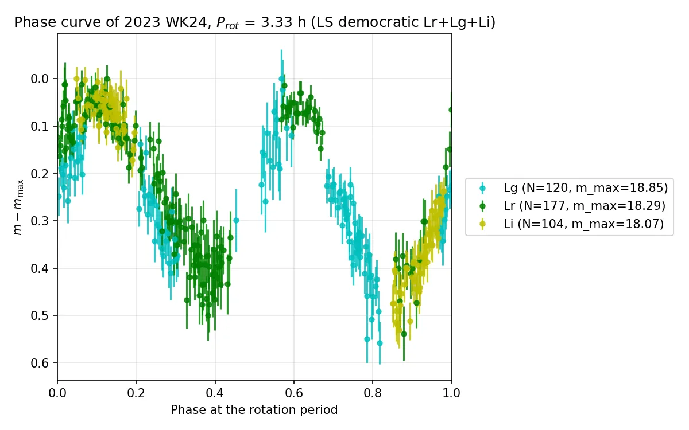
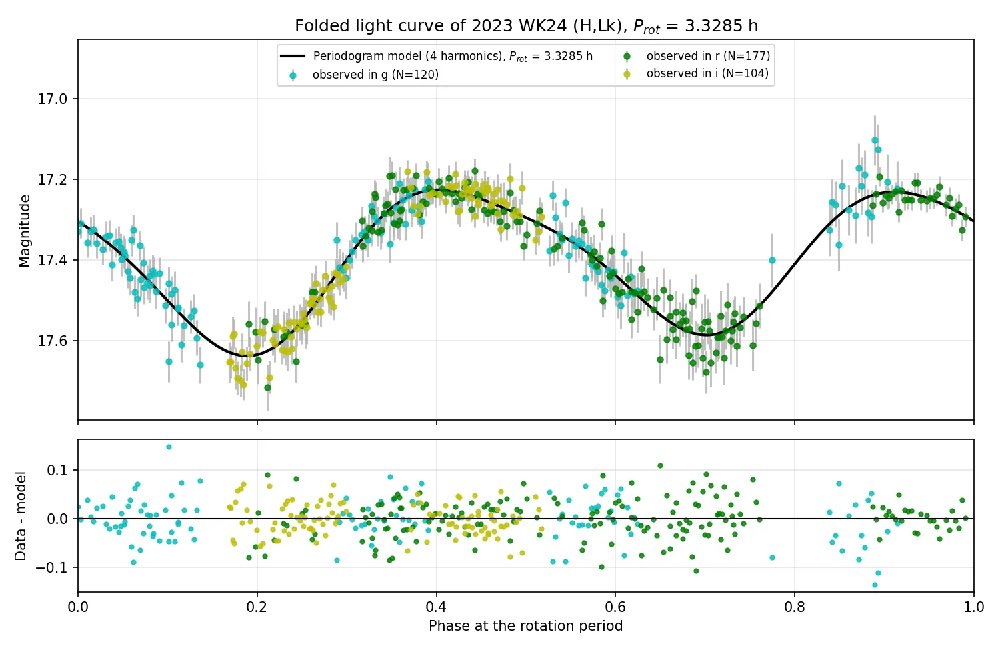
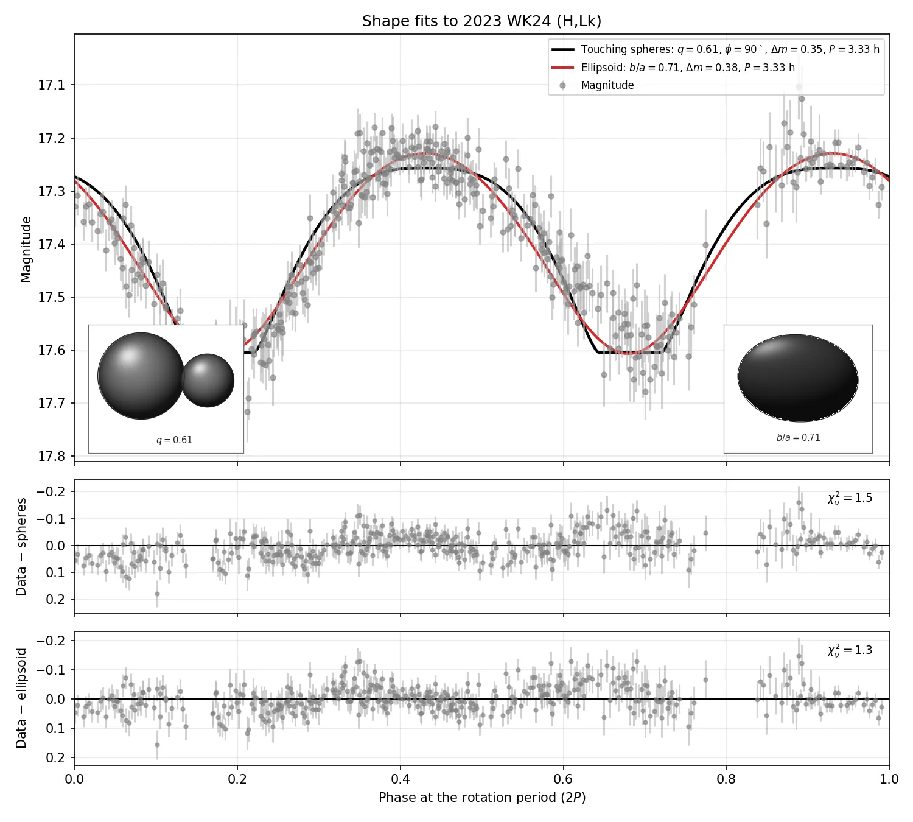

# Medellin VRO Catalogue

## Vera Rubin Observatory Catalogue of the Photometric and Dynamical properties of asteroids


The catalogue was built by Team 5 at [Open Tools, Open Sky: Doing LSST Science with Public Rubin Data & LINCC Frameworks](https://plazasmalagon.com/lsst-science-public-rubin-data-products-hackathon-UdeA-2026/), a LATAM Hack Days workshop held in person at the Universidad de Antioquia, Medellín, Colombia, on 13–15 October 2026. The team was mentored by Pedro Bernardinelli.

- Pedro Bernardinelli, mentor
- Jorge Iván Zuluaga Callejas, Universidad de Antioquia, Colombia
- Juanita Andrea Agudelo, Universidad de Antioquia, Colombia
- Angie Melissa Gutiérrez Estupiñán, Universidad Industrial de Santander, Colombia
- Nicolás Pan, Universidad de la República, Uruguay
- Valeria Judith Burgoa Camacho, Universidad Mayor de San Andrés, Bolivia

The Medellin VRO Catalogue collects 524 asteroids measured in the public Rubin First Look data. Each row is one asteroid. It brings together the provisional designation, the time span and the number of measurements in each filter, the orbit at the first observation, mean absolute magnitudes, colors from the joint multiband light-curve fit, a rotation period chosen by a vote across filters, the parameters of that multiband fit on the synthetic channel Lk, two shape fits of the Lk light curve, a solar-normalized reflectance, and the physical properties reported by the JPL Small-Body Database. A missing value is NaN.

Lk is the magnitude of the summed flux after each filter has been shifted onto one light curve by the fitted colors. Magnitudes in the rotation and shape columns are absolute magnitudes on Lk. The mean values `H_u` … `H_y` stay in the LSST bands.

This release is `medellin-vroc-v19_10_2026.csv`. `medellin-vroc-latest.csv` is a copy of that file. The notebook `zuluaga_dev/dev_build_catalogue.ipynb` writes both, using the date of the run for the versioned name, and also writes the same table to `zuluaga_dev/medellin-vroc.csv`.

```python
import pandas as pd

catalogue = pd.read_csv("medellin-vroc-latest.csv")
catalogue.head()
```

## Gallery

These figures are copies in `gallery/` of the Medellín photometry run, so the README does not point at a particular pipeline directory. The asteroid is **2023 WK24**: 401 measurements in g, r, and i, and a rotation period on which all six vote series agree.

It is the best shape fit in that run under a cut that keeps well-sampled, unanimous, and physically plausible solutions: at least 250 measurements, a unanimous vote, an ellipsoid amplitude between 0.25 and 1 mag, `q` from 0.3 to 0.95, `b/a` from 0.45 to 0.85, a multiband residual below 0.05 mag, and a harmonic amplitude within a factor of two of the ellipsoid amplitude. In that set the ellipsoid reduced chi-squared is 1.30, the lowest, and the touching-spheres value is 1.46.

### Multiband phase curve



Absolute magnitudes in g, r, and i, folded at the voted period of 3.33 h and shifted by the brightest point of each band.

### Multiband light-curve fit



The same measurements, shifted onto Lk and fitted with four Fourier harmonics. The refined period is 3.328 h.

### Shape fit



Touching spheres (`q` = 0.61, reduced chi-squared 1.46) and an equator-on ellipsoid (`b/a` = 0.71, reduced chi-squared 1.30) fitted to the Lk light curve.

The full set of light curves and phase curves is in the [SEAP-UdeA gallery](https://seap-udea.github.io/gallery/?repo=medellin_workshop_solarsystem).

## Columns

### Identification

| Column | Unit | Meaning |
|---|---|---|
| `provid` | | Provisional MPC designation, `YYYY LLnn`. |
| `permid` | | Permanent number: the integer in parentheses in `mpc_designation`. NaN when the asteroid is not numbered. |
| `mpc_designation` | | MPC designation used for the geometry. Numbered objects look like `(4273) Dunhuang`; unnumbered ones keep the provisional designation. |

### Observations

The photometric time span and the number of measurements. These counts are the measurements in the Rubin data, one column per LSST filter.

| Column | Unit | Meaning |
|---|---|---|
| `epoch_utc_ini` | UTC | Time of the earliest measurement, `YYYY-MM-DD HH:MM:SS`. |
| `epoch_utc_end` | UTC | Time of the latest measurement. |
| `n_obs` | | Number of measurements in all filters. |
| `n_obs_u`, `n_obs_g`, `n_obs_r`, `n_obs_i`, `n_obs_z`, `n_obs_y` | | Number of measurements in that filter. |

### Orbit

Elements at `epoch_tdb`, taken from the geometry table at the first observation.

| Column | Unit | Meaning |
|---|---|---|
| `epoch_tdb` | TDB | Epoch of the elements, equal to the time of the first observation. |
| `a` | au | Semimajor axis. |
| `e` | | Eccentricity. |
| `q` | au | Perihelion distance. |
| `incl` | deg | Inclination to the ecliptic. |
| `node` | deg | Longitude of the ascending node. |
| `peri` | deg | Argument of perihelion. |
| `M` | deg | Mean anomaly. |

### Mean absolute magnitudes

Mean absolute magnitude in each LSST band, from `colors.parquet`. These means are not phase-corrected. The colors in the next section come from the joint light-curve fit, so `g-r` is not `H_g − H_r`.

| Column | Unit | Meaning |
|---|---|---|
| `H_u`, `H_g`, `H_r`, `H_i`, `H_z`, `H_y` | mag | Mean absolute magnitude in that LSST band. |

### Phase-corrected colors

Colors from the joint multiband fit. One rotation model is shared by the filters, so a color does not require the two filters on the same night. The reference filter is r. The u measurements are left out of the periodic model and compared with it afterwards. Each color has an `_err` column, the 1-sigma uncertainty from the fit.

| Column | Unit | Meaning |
|---|---|---|
| `u-g`, `g-r`, `r-i`, `i-z`, `z-y` | mag | Color, the difference of the two magnitude offsets. |
| `u-r` | mag | Magnitude offset of u relative to r. |

### Rotation: voted period

The period is chosen by a vote. The voters are the Lomb–Scargle maxima of the three filters with the most measurements, excluding u and y, plus a joint Lomb–Scargle of each consecutive pair and of all three together. Periods that agree to 3%, or whose photometric frequencies differ by one or two cycles per day, count as the same vote. A unanimous vote uses the joint period of all the filters in the vote. Otherwise the reported period is the Lomb–Scargle period of the filter with the most measurements among the series that cast the winning vote.

| Column | Unit | Meaning |
|---|---|---|
| `p_rot_dem_h` | h | Rotation period chosen by the vote. |
| `votes_dem` | | Number of series that voted for that period. |
| `n_series_dem` | | Number of series in the vote. |
| `bands_dem` | | Filters in the vote, for example `Lr+Lg+Li`. |
| `periods_dem_h` | h | Period of each series, written as `Lr=3.33,Lg=3.33,Lr+Lg=3.33`. |

### Rotation: multiband fit on Lk

The light curve is taken to be double-peaked, so the rotational period is twice the photometric period. The fit uses between 2 and 10 Fourier harmonics and keeps the order with the lowest Bayesian information criterion. `p_rot_multi_used_h` is the period that starts the fit, here the voted period. `p_rot_multi_h` is the period after the fit.

| Column | Unit | Meaning |
|---|---|---|
| `p_rot_multi_used_h` | h | Period used to start the multiband fit. |
| `p_rot_multi_h` | h | Rotational period from the fit, `24 / f_rot_multi`. |
| `f_rot_multi` | d⁻¹ | Rotational frequency. |
| `k_harm_multi` | | Number of Fourier harmonics in the adopted model. |
| `bic` | | Bayesian information criterion of that model. |
| `amp_lsm_k` | mag | Peak-to-peak amplitude of the harmonic model on Lk over one cycle. |
| `amp_photo_k` | mag | Width of the Lk magnitudes between the 1st and 99th percentiles, after clipping residuals at 3σ. |
| `rms_multi` | mag | Root-mean-square residual of the joint fit. |
| `n_outliers_multi` | | Number of measurements rejected by the clip. |

### Shape: touching spheres on Lk

Two spheres in contact, fitted to the folded Lk light curve. `q_sph_k` is reported with the smaller sphere second, so it is at most 1. The spin axis makes an angle `phi_sph_deg_k` with the line of sight: 90° is equator-on and 0° is pole-on.

| Column | Unit | Meaning |
|---|---|---|
| `q_sph_k` | | Radius ratio `r2/r1`. |
| `q_sph_err_k` | | Uncertainty of `q_sph_k`. |
| `phi_sph_deg_k` | deg | Angle between the spin axis and the line of sight. |
| `phi_sph_err_deg_k` | deg | Symmetric uncertainty of that angle. NaN when the fit only gives a lower limit. |
| `chi_r_sph_k` | | Reduced chi-squared of the fit. |
| `amp_sph_k` | mag | Peak-to-peak amplitude of the model. |
| `m_mid_sph_k` | mag | Midpoint of the model curve, halfway between its brightest and faintest magnitudes. |
| `m_sep_k` | mag | Magnitude when the two disks are fully separated. |
| `p_rot_sph_h_k` | h | Rotation period refined by the fit. |

### Shape: ellipsoid on Lk

Equator-on triaxial ellipsoid (`phi = 90°`) rotating about its short axis. The long axis is `a = 1`.

| Column | Unit | Meaning |
|---|---|---|
| `b_over_a_k` | | Axis ratio `b/a`. |
| `b_over_a_err_k` | | Uncertainty of `b/a`. |
| `amp_ell_k` | mag | Peak-to-peak amplitude of the model. |
| `m_mid_ell_k` | mag | Midpoint of the model curve. |
| `m_ab_k` | mag | Magnitude of the `a`–`b` face, the brightest aspect when seen equator-on. |
| `p_rot_ell_h_k` | h | Rotation period refined by the fit. |
| `chi_r_ell_k` | | Reduced chi-squared of the fit. |

### Reflectance

Solar-normalized reflectance from the joint light-curve colors, relative to r, where `R(r) = 1`. The solar colors subtracted from `m_b − m_r` are g−r = 0.45, i−r = −0.12, z−r = −0.16, and y−r = −0.18. The reflectance is `10^(−0.4 × excess)`.

For the g, i, z, and y filters, written below as `b`:

| Column | Unit | Meaning |
|---|---|---|
| `{b}-r_spec` | mag | Color `m_b − m_r`. For g this equals `g-r`. For i it equals `−(r−i)`. |
| `{b}-r_spec_err` | mag | Uncertainty of that color. |
| `R_b` | | Solar-normalized reflectance `R(b)/R(r)`. |
| `R_b_err` | | Uncertainty of the reflectance. |
| `n_b_spec` | | Number of measurements in filter `b`. |

The stored names are `g-r_spec`, `R_g`, `n_g_spec`, and the same pattern for i, z, and y.

### SBDB physical parameters

From the JPL Small-Body Database. The number is stored without its unit. Each quantity has an `_err` column; that uncertainty is NaN when SBDB does not give a numeric error. Taxonomic classes have no numeric error.

| Column | Unit | Meaning |
|---|---|---|
| `H_sbdb` | mag | Absolute magnitude. |
| `albedo_sbdb` | | Geometric albedo. |
| `diameter_sbdb` | km | Diameter. |
| `extent_sbdb` | km | Axis extents, kept as text `a x b` or `a x b x c`. |
| `pole_sbdb` | deg | Ecliptic pole, kept as text `longitude/latitude`. |
| `density_sbdb` | g cm⁻³ | Bulk density. |
| `rot_per_sbdb` | h | Rotation period in the literature. |
| `GM_sbdb` | km³ s⁻² | Gravitational parameter. |
| `BV_sbdb` | mag | Color B−V. |
| `UB_sbdb` | mag | Color U−B. |
| `spec_B_sbdb` | | Bus taxonomic class. |
| `spec_T_sbdb` | | Tholen taxonomic class. |

### Dynamics

Reserved for a mean-motion resonance. They are not computed yet, so every value is NaN.

| Column | Unit | Meaning |
|---|---|---|
| `res_body` | | Planet the asteroid is resonant with. |
| `res_flag` | | Whether a resonance is identified. |
| `res_type` | | Kind of resonance. |
| `res_kp` | | One integer of the resonance. |
| `res_k` | | The other integer of the resonance. |
| `res_orbit` | | Description of the resonant orbit. |

## Suggested papers

- [Kurlander et al. (2025)](https://doi.org/10.3847/1538-3881/add685), Predictions of the LSST Solar System Yield: Near-Earth Objects, Main Belt Asteroids, Jupiter Trojans, and Trans-Neptunian Objects
- [Murtagh et al. (2025)](https://doi.org/10.3847/1538-3881/ade1db), Predictions of the LSST Solar System Yield: Discovery Rates and Characterizations of Centaurs
- [Murtagh et al. (2026)](https://doi.org/10.3847/1538-3881/ae27bd), Predictions of the LSST Solar System Yield: Neptune Trojans
- [Merritt et al. (2025)](https://doi.org/10.3847/1538-3881/add3ec), Sorcha: A Solar System Survey Simulator for the Legacy Survey of Space and Time
- [Holman et al. (2018)](https://doi.org/10.3847/1538-3881/aad69a), HelioLinC: A Novel Approach to the Minor Planet Linking Problem
- [Greenstreet et al. (2026)](https://doi.org/10.3847/2041-8213/ae2a30), Lightcurves, Rotation Periods, and Colors for Vera C. Rubin Observatory's First Asteroid Discoveries
- [Vavilov et al. (2026)](https://arxiv.org/abs/2610.07584), Discovery of 2 km Ultra-fast Rotating Asteroid in Rubin DP2 Catalog via Varying Fourier Order Method
- [Showalter et al. (2021)](https://doi.org/10.1016/j.icarus.2020.114098), A statistical review of light curves and the prevalence of contact binaries in the Kuiper Belt
- [Chow et al. (2026)](https://doi.org/10.3847/1538-4357/ae4e23), Predictions of Imminent Earth Impactors Discovered by LSST
- [Cheng et al. (2026)](https://doi.org/10.3847/1538-3881/ae5936), Assessing the Vera C. Rubin Observatory's Ability to Discover Asteroid Impactors before They Collide with Earth
- [Dorsey et al. (2025)](https://doi.org/10.3847/PSJ/adf8ca), The Visibility of the Ōtautahi–Oxford Interstellar Object Population Model in LSST
- [Bernstein et al. (2025)](https://doi.org/10.3847/PSJ/ade3de), Determinations of Asteroid Masses Using Mutual Encounters Observed in the Legacy Survey of Space and Time
- LSST Predictions [AAS Focus issue](https://iopscience.iop.org/collections/PSJ-250528-01)

## Data access

- [B612 Foundation mirror of LSST data on the MPC](https://b612.ai/rubin-mpc-downloads/)
- Individual objects in the [Minor Planet Center](https://www.minorplanetcenter.net)

## Disclaimer

As of 19 October 2026, this repository has not been properly curated. The scripts and notebooks are not adequately documented, because the project was developed jointly during [Open Tools, Open Sky: Doing LSST Science with Public Rubin Data & LINCC Frameworks](https://plazasmalagon.com/lsst-science-public-rubin-data-products-hackathon-UdeA-2026/). As the final scientific report is prepared, the repository and the pipeline will be documented accordingly.

## Acknowledgements

The authors express their gratitude to the organizers of the 'Open Tools, Open Sky: Doing LSST Science with Public Rubin Data & LINCC Frameworks' workshop, especially Juan Carlos Muñoz-Cuartas, Andrés A. Plazas Malagón, and all participating mentors and staff. We thank the Universidad de Antioquia (Medellín, Colombia) and the Institute of Physics’ FACom research group for their hospitality. We acknowledge support from the LSST Discovery Alliance (LSST-DA), the LINCC Frameworks initiative funded by Schmidt Sciences, the Vera C. Rubin Observatory Project Office, and the Minor Planet Center (MPC).

## AI Disclosure

Portions of the code review, refactoring, inline documentation, debugging, and repository restructuring in this project were assisted by AI language models (used as coding assistants inside Cursor and related tools).

The human authors assert that all scientific ideas, the overall project conception, the design of the numerical and scientific experiments, the interpretation of the results, and the conclusions drawn from this catalogue are original contributions of the human authors. AI tools were used exclusively as coding and writing assistants — analogous to a spell-checker or a compiler — and bear no intellectual authorship over the scientific content of this work. AI models also assisted with translation from Spanish (the native language of several authors) into English, and with English spelling and grammar review.
